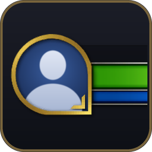
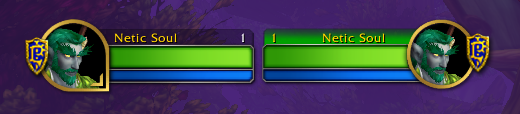

  

<h1 align="center">Retail HD UnitFrames</h1>

HD retail-style unit frames for WoW Forever.

  
  
  
  
  

  

## Features

- HD art on the player, target, focus, their targets, pet and party frames
- Health and power texts: number, percent or both, abbreviated, always or on mouseover
- Class-colored health and the red health-loss animation
- Incoming heals and absorbs on the target and focus
- Aggro glow on party members
- Level and PvP icons in retail or Forever style, or hidden
- Dark mode, in any color
- Optional group tab, threat percentage and name background
- Setup wizard and minimap button
- English, Español, Deutsch, Français, Русский

## Usage

| Command | Opens |
| --- | --- |
| `/rhd` or `/retailhd` | Options |
| `/rhd wizard` | Setup wizard |

Also in **Options › AddOns** and in the minimap's addon menu.

## License

MIT © NeticSoul. Art from DragonflightUI and SeamlessUnitframes (MIT), see [LICENSE](LICENSE).

Provided as is. Issues are closed.
